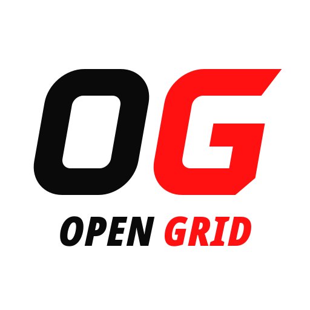

<p align="center">
  <picture>
    <source media="(prefers-color-scheme: dark)" srcset="docs/media/logo/open-grid-logo-transparent.svg">
    
  </picture>
</p>

# Open Grid

Open-source, non-profit street & circuit racing simulator built around an engine-independent **C++20 vehicle physics core (`core/`)** targeting **Unreal Engine 5.8** natively, with a full playable **WebGPU + WebAssembly** browser build (`web/`) and a **$0/month Cloudflare Workers + D1** competitive online network (`cloud/`).

**[Play live at open-grid.racing](https://open-grid.racing/)** · **[Official YouTube (@open_grid_motorsport)](https://youtube.com/@open_grid_motorsport)** · **[Sponsor on GitHub](https://github.com/sponsors/Konstantinos-Chatzistavrou)**

Desktop Chrome or Edge recommended (keyboard, controller, or force-feedback wheel); phones and tablets get the same game in a lighter touch mode ([docs/platforms.md](docs/platforms.md)).

> **An independent open-source hobby project.** Built for the love of racing and maintained in spare time: free, non-profit, ad-free. Issues and pull requests are welcome and are read when time allows; online services are best-effort. Details in [docs/MAINTENANCE.md](docs/MAINTENANCE.md).

<!-- Media: drop the files into docs/media/ (shot list: docs/media/SHOTLIST.md), then delete this comment's markers.
[](docs/media/trailer.mp4)

| | |
|---|---|
|  |  |
|  |  |
-->

---

## Highlights & Architecture

| Pillar | What Is Shipped Today |
|---|---|
| **C++20 Physics Core (`core/`)** | Engine-independent `rs_core` (130 CTests, GCC + MSVC + WASM): Pacejka MF 5.2/6.1 tyres with 24-node deformable carcass ring, 3-zone tyre thermals & pressure, 16-point contact patch, explicit 3D double-wishbone/MacPherson suspension kinematics, per-car transmissions (`manual`, `dct`, `auto_tc`, `sequential`), physics-up Controller Steering Filter (`Off/Sim/Assisted`, wheels always 1:1) & Corner Braking Assist (`Off/Low/High`), driveline torsional compliance, aero/active aero (DRS & airbrake on declared cars), brake thermals/boil, fuel load, dynamic weather, per-panel crash damage, FIA Race Control (`race_control.cpp`), server-authoritative anti-cheat (`authority.cpp`), and race AI (`125/125` laps on track across all 25 cars × 5 circuits). See **[docs/physics.md](docs/physics.md)** and **[docs/validation.md](docs/validation.md)**. |
| **Unreal Engine 5.8 Target (`ue5/`, `ue5_plugin/`)** | Native `OpenGridPhysics` plugin (`UOpenGridVehicleComponent`, `AsyncVehicleBridge` @ 400–1000 Hz, single-unit `RsCoreUnity.cpp` verified on Windows MSVC every push), `AOpenGridCarPawn`, customization/damage/MetaSound/race/online C++ components, 1-click Editor importer (`tools/ue5/ue5_import_all.py`), 3D Tokyo Night LUTs, and Nanite high-poly car & 14-part modular GLB exporters. See **[docs/ue5_roadmap.md](docs/ue5_roadmap.md)** and **[docs/ue5_first_session.md](docs/ue5_first_session.md)**. |
| **WebGPU Browser Build (`web/`)** | Three.js r187 (WebGPU with automatic WebGL 2 fallback), Rapier 3D rigid bodies, WebAssembly `rs_core.wasm`, 25 de-branded cars, 5 real-scale 1:1 cities (NYC Midtown, London, Paris, Tokyo, LA), destructible street furniture & building breaches, tactical police AI, 2-player local Split-Screen, Walkable Garage, CS2-style live Auction House, 4K Photo Mode (`[P]`), 5-minute Cinematic Replay (`[T]`), and client-side Race Spotter. |
| **Live A/B Audio Engine** | Switch live in **Settings** or **Garage** between **43 ear-verified real recorded CC BY 3.0 supercar stems** (Corvette Z06, Mustang, Ferrari 458/F12/812, GT3, Huracán, GT-R, Supra, RX-7, etc.) and our **Thermodynamic Engine-Sim + 192-Tap Exhaust Muffler IR** WebAssembly synth (`engine_audio.cpp`), plus UE 5.8 MetaSound stems (`docs/ue5_audio_metasounds.md`). |
| **Community Online Network (`cloud/`)** | Live at `https://opengrid.opengrid-racing.workers.dev` (custom domain ready: `api.open-grid.racing`) on Cloudflare Workers + D1 + Durable Objects (**100% free & ad-free, best-effort** on the Cloudflare free plan — zero paywalls, zero trials, no Patreon; optional **[GitHub Sponsors](https://github.com/sponsors/Konstantinos-Chatzistavrou)**). Features real Email+Password PBKDF2-SHA256 & Google/GitHub/Discord OAuth2 login, automated Glicko-2 Driver Rating (DR), Fault-Aware Safety Rating (SR `0.00–4.99` with `0x Victim Shield`), License Ladder (`R → PRO`), Scheduled Community SOF Splits, Seasonal Championships (best 8 of 12 rounds), Season Disconnect Jokers, Global Hotlap Leaderboards, Endurance Teams, Hosted Private Leagues, PeerJS WebRTC P2P voice chat, and a free automated GitHub Actions C++20 deterministic replay verifier (`opengrid_replay_verifier`). See **[cloud/README.md](cloud/README.md)**. |
| **Standalone Package & Bots (`packages/vehicle-physics/`)** | `open-grid-physics`: drop-in WebAssembly vehicle physics package for any JS/TS engine, plus a headless **[Bot API](docs/bots.md)** running at 100× real time. |

Help wanted: drivers on wheels to test force feedback ([testing program](docs/testing_program.md), [FFB test plan](docs/ffb_test_plan.md)), 3D artists, UE 5.8 contributors, and bot writers. Start with [CONTRIBUTING.md](CONTRIBUTING.md).

---

## System Requirements

- **Browser**: WebGPU where enabled by default: Chrome / Edge 113+ on Windows, macOS, ChromeOS; Chrome 121+ on Android 12+; Safari 26; Firefox 141+ on Windows. Everywhere else (including Linux Chrome without flags), Open Grid falls back automatically to WebGL 2 (`?webgl=1` forces WebGL 2; on Linux Chrome you can enable `chrome://flags` → **Unsafe WebGPU Support**).
- **Graphics card (what matters)**: the game is limited by the GPU, not the CPU (the physics for 8 cars costs about 0.5 ms a frame). On the integrated graphics of a laptop it runs at around 30 fps, and the built-in automatic tuner lowers resolution and effects first to hold that. A dedicated graphics card or a recent Apple M-series chip should do much better, but **no measured numbers exist for those yet**.
- **Minimum / recommended**: there is no spec sheet yet, because there is no measured data to base one on. Minimum is anything that runs the browsers above and can run WebGL 2. Recommended is a dedicated GPU, with Chrome or Edge. Phones and tablets run a lighter touch mode ([docs/platforms.md](docs/platforms.md)).
- **Help build the real table**: open the game, choose **Benchmark** on the title menu, and post the copied result (GPU, browser, fps per quality preset) in an issue. Reports from many different machines turn this section into a measured table instead of a guess.
- **Development**: Node 24+ (or 20+), CMake 3.16+, C++20 compiler (GCC 13+, Clang 16+, or MSVC 2022+).
- **Native / UE 5.8 Target**: 64-bit x86_64/ARM64 CPU, 8 GB+ RAM, Vulkan 1.2 / DirectX 12 GPU.
- **Sim Telemetry (optional)**: Run `node tools/simhub_udp_bridge.mjs` for 60 Hz 311-byte Forza/SimHub Dash V2 UDP packets (`127.0.0.1:20777`), or export **MoTeC i2 Pro** (`.ld` / `.ldx`) logs directly from the Pause or Results screen.

---

## Quick Start

### 1. Clone the repository

The repository history carries city and car assets (~1.4 GB). Use a blobless or shallow clone for fast code work:

```bash
# Recommended: full commit history, blobs downloaded on demand
git clone --filter=blob:none https://github.com/Konstantinos-Chatzistavrou/Open-Grid.git

# Latest snapshot only (smallest)
git clone --depth 1 https://github.com/Konstantinos-Chatzistavrou/Open-Grid.git

# Physics core & car data only
git clone --filter=blob:none --sparse https://github.com/Konstantinos-Chatzistavrou/Open-Grid.git
cd Open-Grid && git sparse-checkout set core packages data/cars data/tires web/wasm web/src/physics
```

### 2. Run the browser build

```bash
cd web
npm install
npm run dev          # http://127.0.0.1:5173
```

Useful URL flags: `?scale=0.75`, `?quality=max|ultra|high|medium|low|potato`, `?webgl=1`, `?bloom=0`, `?aa=0`, `?shadows=0`, `?menu=0`, `?user=NAME`.

To rebuild the WebAssembly physics/audio modules after editing `core/` (requires [Emscripten](https://emscripten.org/docs/getting_started/downloads.html) in `~/emsdk`):

```bash
bash web/wasm/build.sh         # rebuilds web/src/physics/rs_core.{js,wasm}
bash web/wasm/build_audio.sh   # rebuilds thermodynamic engine audio WASM
```

### 3. Build & test the native C++20 physics core

```bash
cmake -S core -B core/build -DCMAKE_BUILD_TYPE=Release
cmake --build core/build -j
ctest --test-dir core/build --output-on-failure --parallel "$(nproc)"
```

Optional deep validation flags:

```bash
# Test all 25 shipped cars across all 5 real circuits (125 laps)
RS_ALL_CARS=1 ctest --test-dir core/build --output-on-failure --parallel "$(nproc)"

# Run with the full game physics models enabled
RS_GAME_MODELS=1 ctest --test-dir core/build --output-on-failure --parallel "$(nproc)"

# Run a 40-lap GT3 tyre thermal & wear stint on Brands Hatch GP
RS_STINT=40 ./core/build/rs_tests reference_data_stint

# Run the headless C++20 anti-cheat replay verifier
./core/build/opengrid_replay_verifier data/cars/falcorn_9r.json <replay.json>
```

### 4. Run the online backend locally (`cloud/`)

```bash
cd cloud
npm install
npm run db:local
npm run dev                 # http://127.0.0.1:8787 (picked up automatically by web dev server)
npm run test:pace && npm run test:competitive
```

---

## Controls, Wheels & Force Feedback

The last device touched drives; switch seamlessly between keyboard, gamepad, steering wheel, and touch.

- **Keyboard**: `W`/`S` throttle & brake · `A`/`D` steer · `Q`/`E` shift · `Space` handbrake · `Shift` clutch · `X` nitrous · `F` flash headlights (1v1 drag challenge in Free Roam) · `Z` Push-to-Talk voice · `R` recover · `C` camera · `M` / `Tab` GPS map · `P` 4K Photo Mode · `T` 5-min Replay · `1` ABS · `2` TC · `3` ESC · `5` auto gearbox · `H` hide HUD · `Esc` pause.
- **Controllers**: Standard Gamepad API (Xbox, DualShock 4, DualSense, Switch Pro) with physics-driven vibration (tyre scrub, slip, ABS, crashes) and full menu navigation + 2-player local Split-Screen.
- **Steering Wheels & WebHID Force Feedback**: Any HID wheel calibrates in **Controls** with 1:1 steering. WebHID FFB (Chrome/Edge desktop) drives steering-rack aligning torque, speed damping, soft lock, and impact jolts over USB HID PID (Moza, Simucube, Simagic, Asetek, Cammus, VRS, OpenFFBoard) and Logitech classic protocol (DFGT, G25, G27, G29, G923 PS). Byte formats are unit-tested (`node web/tools/test_ffb.mjs` & `web/tools/ffb_signal_check.mjs`), **not yet verified on physical wheel hardware** — testers welcome!
  - Linux `udev` rule (`/etc/udev/rules.d/70-opengrid-wheels.rules`):
    ```
    KERNEL=="hidraw*", ATTRS{idVendor}=="046d|044f|0eb7|346e|3670|3416", TAG+="uaccess"
    ```
    Then run `sudo udevadm control --reload && sudo udevadm trigger` and reconnect the wheel.
- **Phones & Tablets**: Touch pedals/steering or **Tilt Steering** (35° full lock) with haptic feedback.

---

## Multiplayer & Non-Profit Online Network

Open Grid separates **free-forever base play & private P2P** from the **community ranked network** (free and best-effort, see [docs/MAINTENANCE.md](docs/MAINTENANCE.md)):

- **Free Forever (Zero Ads, Zero Hostage Content):** All 25 cars, all 5 cities, Single Player career, Testing Mode, Walkable Garage, Auction House, 2P Split-Screen, Friends, and **Private P2P Parties** (up to 16 players in Free Roam / 12 in Race Events over WebRTC PeerJS, with `[Z]` Push-to-Talk & proximity Car Meet voice chat). You can also self-host the PeerJS broker (`server/`).
- **Big lobbies are self-hosted (optional):** anyone with a server can run the room server (`server/rooms.js`) for Free Roam lobbies of 64+ players, joined with `?server=your-host`; it is theirs to run and pay for, like a Minecraft server. See **[docs/self_hosting.md](docs/self_hosting.md)**. The official setup stays on free plans ([docs/COSTS.md](docs/COSTS.md)).
- **Community Ranked Network (`cloud/` on Cloudflare Workers + D1, 100% Free & Ad-Free):**
  - **Free for every account, everywhere.** Sign in as a guest, with Email+Password, or with Google, GitHub or Discord. There is no paid tier, no Patreon, and no trial countdown; optional **[GitHub Sponsors](https://github.com/sponsors/Konstantinos-Chatzistavrou)** buys no perks and simply supports the hobby project.
  - **Automated Dual Rating & Licenses:** Glicko-2 Driver Rating (`DR 800–3500`, Grade `E → S`), Automated Fault-Aware Safety Rating (`SR 0.00–4.99` with `0x Victim Shield`), License Ladder (`R → D → C → B → A → PRO`), Bad-Sport Quarantine splits, and **Season Disconnect Jokers**.
  - **Scheduled Community Series & SOF Splits:** Automated recurring splits (Rookie GT Sprint 20m, GT3 World Championship 45m, Hypercar Pro 60m, Multiclass Endurance 120m), balanced Strength-of-Field seeding, and seasonal championships (car lock + best 8 of 12 rounds).
  - **Automated Anti-Cheat & Race Control:** Zero human-in-the-loop stewarding required — in-race physics penalties & fault scoring run automatically, and top-3 replays are verified off-device by our C++20 `opengrid_replay_verifier` on free GitHub Actions.
  - **Global Hotlaps, Teams & Leagues:** Auto-uploaded verified clean laps on Global Hotlap Leaderboards, Endurance Teams, and password-protected Hosted Private Leagues.

---

## CI & Automated Verification

Every push and scheduled run validates the codebase automatically:

| Workflow | Schedule | What It Verifies |
|---|---|---|
| **[ci.yml](.github/workflows/ci.yml)** | Every push & PR | GCC C++20 Release (128 CTests) · GCC `-O1` ASan+UBSan · Windows MSVC Release + UE 5.8 single-unit `RsCoreUnity.cpp` compile · Car physics/anti-cheat validator · Licence ledgers · Powertrain/aero/inertia/torque/Chrono/brake/track physics references · `open-grid-physics` package tests · WebGPU `tsc && vite build` · Cloudflare Worker `tsc`, `test:pace` (17 checks), `test:competitive` (11 checks). |
| **[nightly_asan_o0.yml](.github/workflows/nightly_asan_o0.yml)** | Nightly `03:00 UTC` | Unoptimized **`-O0 -g` ASan + UBSan** build across all 128 CTests to catch edge cases that `-O1` can mask or report differently. |
| **[weekly_full_fleet.yml](.github/workflows/weekly_full_fleet.yml)** | Weekly Sun `04:00 UTC` | Full 25-car fleet across all 5 real circuits (`125 laps`) under **`RS_ALL_CARS=1`** and **`RS_ALL_CARS=1 RS_GAME_MODELS=1`** (plus diagnostic tracking of the known Kestrel dog-box shift-cut check). |
| **[replay_verifier.yml](.github/workflows/replay_verifier.yml)** | Every 30 min (when configured) | Builds headless C++20 `opengrid_replay_verifier` and audits pending ranked race replays from Cloudflare D1 (`AuthorityServerSim` + `AntiBotAnalyzer`). |

### Validation Snapshot

- **Corvette C7 Z51 baseline** (checked every push): 0–60 mph `3.95 s` (real `3.8–3.9 s`), 60–0 mph `32.5 m` (real `31.7–32.6 m`), skidpad `1.00 g` (real `1.03–1.11 g`), top speed `291 km/h` (real `~290`). WASM reproduces native results.
- **Tornado GT3 calibration**: quasi-steady lap within `+4.3%` (Spa) and `+1.1%` (Brands Hatch GP) of real GT3 qualifying references (`data/physics/gt3-lap-references.json`).
- **Full fleet AI**: `125/125` laps complete on-track (`RS_ALL_CARS=1`, 25 cars × 5 circuits).
- Full methodology, citations, and explicit uncalibrated areas (tyre stint wear/blistering, physical FFB hardware): **[docs/physics.md](docs/physics.md)** & **[docs/validation.md](docs/validation.md)**.

---

## Repository Layout

| Path | Description |
|---|---|
| `core/` | Engine-independent C++20 physics, race control, audio DSP, AI, anti-cheat verifier (`opengrid_replay_verifier`), and 128 CTests |
| `ue5/` & `ue5_plugin/` | Unreal Engine 5.8 project shell, `OpenGridPhysics` C++ plugin (`RsCoreUnity.cpp`), pawn/audio/damage/online components |
| `web/` | Playable browser client: Three.js r187 WebGPU/WebGL 2, Rapier 3D, WASM bridge (`web/wasm/`), PeerJS P2P voice & poses, Race Spotter |
| `cloud/` | Live Cloudflare Workers + D1 + Durable Objects backend (auth, Patreon webhooks/OAuth2, DR/SR, SOF splits, championships, protests, hotlaps, teams, leagues) |
| `packages/vehicle-physics/` | Standalone `open-grid-physics` WebAssembly npm package & headless Bot API |
| `server/` | Optional self-hosted services: PeerJS signaling broker and the big Free Roam room server (`rooms.js`) |
| `data/` | Engine-neutral JSON car physics (25 cars), tyres, validation datasets, UE5 DataTables/LUTs, i18n string tables |
| `tools/` | Asset/Blender pipelines, UE 5.8 exporters & importer, SimHub UDP bridge, physics reference validators, replay verifier runner |
| `assets_source/` | Source art masters and tracked licence provenance ledgers (`tools/assets/check_licences.mjs`) |
| `docs/` | Complete architecture, physics, validation, UE 5.8, audio, modding, and art documentation |

### Key Documentation Index

- **[docs/BRAND_IDENTITY.md](docs/BRAND_IDENTITY.md)** — Official brand palette (`#0A0A0A` Carbon Black, `#FF1111` Racing Red, Crisp White, Cool Titanium Gray) & Pit-Wall Motorsport typography (`Barlow Condensed` + `Barlow` + `JetBrains Mono`)
- **[docs/DESIGN.md](docs/DESIGN.md)** — Master game design & architecture blueprint
- **[docs/physics.md](docs/physics.md)** & **[docs/validation.md](docs/validation.md)** — Physics equations, game-model flags, validated vs. uncalibrated items
- **[docs/ue5_roadmap.md](docs/ue5_roadmap.md)** & **[docs/ue5_first_session.md](docs/ue5_first_session.md)** — UE 5.8 migration boundary & 1-click Editor import guide
- **[docs/ue5_audio_metasounds.md](docs/ue5_audio_metasounds.md)** — MetaSounds patch wiring & 48 kHz/24-bit audio stems
- **[docs/MODDING.md](docs/MODDING.md)** & **[docs/adding_a_car.md](docs/adding_a_car.md)** — Open car modding pipeline & validator
- **[cloud/README.md](cloud/README.md)** & **[docs/design/multiplayer-anti-cheat.md](docs/design/multiplayer-anti-cheat.md)** — Online backend API, Patreon setup, capacity math & anti-cheat
- **[docs/MAINTENANCE.md](docs/MAINTENANCE.md)** — What to expect from this hobby project: support, online services, accounts, what is not promised
- **[docs/COSTS.md](docs/COSTS.md)** & **[docs/self_hosting.md](docs/self_hosting.md)** — What the project runs on (free plans, the domain is the only recurring cost) and how to host a big Free Roam server yourself
- **[docs/PROJECT_MEMORY.md](docs/PROJECT_MEMORY.md)** — Developer handoff & operational architecture reference

---

## Licence

Dual-licensed by asset type (full per-directory breakdown in [LICENSING.md](LICENSING.md)):

- **Code** (`core/`, `web/`, `cloud/`, `ue5_plugin/`, `packages/`, `server/`, `tools/`): **Apache License 2.0** (`LICENSE`, `NOTICE`, SPDX `Apache-2.0`).
- **Original art, data & docs** (3D models, textures, car/track JSONs, docs): **Creative Commons Attribution-NonCommercial 4.0** (`LICENSES/CC-BY-NC-4.0.txt`, SPDX `CC-BY-NC-4.0`) — free to share and adapt non-commercially with credit.
- **Name & Logo**: Not licensed; forks may use the code and (non-commercially) the art, but must not call themselves *Open Grid* or use the logo (see [LICENSING.md](LICENSING.md)).
- **Third-party assets** retain their upstream licences, tracked in [CREDITS.md](CREDITS.md) and checked on every push by `tools/assets/check_licences.mjs` (OpenStreetMap `ODbL`, Project Chrono `BSD-3-Clause`, car audio stems `CC BY 3.0`, derived car meshes `CC BY 4.0`, kit props/textures `CC0`).
