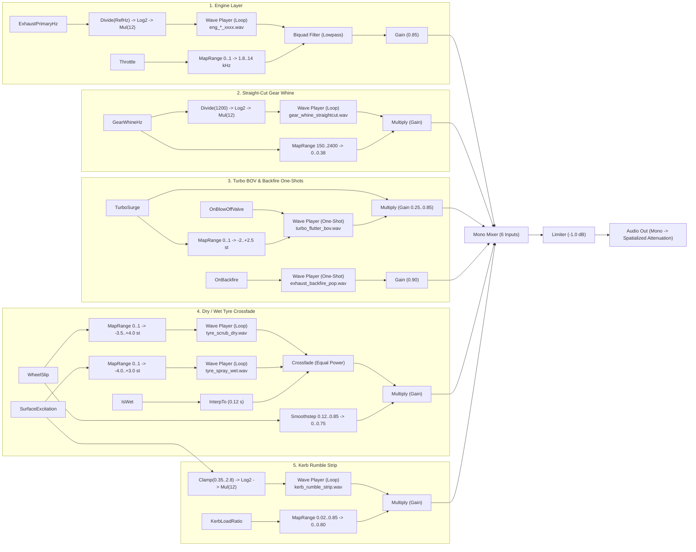

# UE 5.8 Vehicle Audio: MetaSound Patch Wiring Guide

OpenGrid ships a procedural **48 kHz / 24-bit mono PCM WAV** audio stem generator (`tools/ue5/generate_audio_stems.py`) with zero third-party samples (`CC-BY-NC-4.0`, tracked provenance ledger in `assets_source/audio/manifest.json`). This guide wires all 11 stems into a UE 5.8 MetaSound Source (`MSS_OpenGridVehicle`) driven directly by `UOpenGridVehicleComponent` and `UOpenGridMetaSoundComponent` (`ue5/Source/OpenGrid/OpenGridMetaSoundComponent.h`).

---

## 1. Generating & Importing Stems into UE 5.8

1. Generate and verify all 11 stems locally (large WAVs write to gitignored `ue5/Import/Audio/`):
   ```bash
   python3 tools/ue5/generate_audio_stems.py --verify
   ```
2. Drag `ue5/Import/Audio/*.wav` into `/Game/OpenGrid/Audio/Stems/` in the UE 5.8 Content Browser.
3. Recommended `USoundWave` import settings for every **loop** stem:
   - **Looping**: `False` on the `USoundWave` asset (let the MetaSound `Wave Player` node control looping cleanly).
   - **Loading Behavior**: `Retain on Load` (eliminates first-frame streaming hitch on rapid pitch/trigger changes).
   - **Compression Quality**: `100` (or `PCM` / `ADPCM` override on engine/gear loops so zero-crossing loop boundaries stay click-free).
4. Assign your MetaSound Source (`MSS_OpenGridVehicle`) to `UOpenGridMetaSoundComponent::EngineSoundAsset` on the car pawn (`bAutoPlay = true`).

---

## 2. Stem Reference Table (`48 kHz / 24-bit`, RMS `-14 dBFS`)

| Stem File | Category | Loop | Ref RPM | Ref `f0` (Hz) | MetaSound Pitch Formula (Semitones) |
|---|---|---:|---:|---:|---|
| `eng_flat6_4000.wav` | Engine | Yes (2.0 s) | 4000 | `200.0` | `12 * log2(clamp(ExhaustPrimaryHz, 35, 650) / 200.0)` |
| `eng_v12_5000.wav` | Engine | Yes (2.0 s) | 5000 | `500.0` | `12 * log2(clamp(Rpm * 12 / 120, 80, 1200) / 500.0)` |
| `eng_rotary4_6000.wav` | Engine | Yes (2.0 s) | 6000 | `400.0` | `12 * log2(clamp(Rpm * 4 / 60, 70, 1000) / 400.0)` |
| `eng_tt_i6_4000.wav` | Engine | Yes (2.0 s) | 4000 | `200.0` | `12 * log2(clamp(ExhaustPrimaryHz, 35, 650) / 200.0)` |
| `eng_sc_v8_whine.wav` | Engine | Yes (2.0 s) | 4000 | `266.5` | `12 * log2(clamp(Rpm * 8 / 120, 45, 700) / 266.5)` |
| `gear_whine_straightcut.wav` | Drivetrain | Yes (2.0 s) | — | `1200.0` | `12 * log2(clamp(GearWhineHz, 180, 4800) / 1200.0)` |
| `turbo_flutter_bov.wav` | Induction | No (1.1 s) | — | `1800.0` | `MapRange(TurboSurge, 0..1 -> -2.0..+2.5)` + `Random(-0.8..+0.8)` |
| `exhaust_backfire_pop.wav` | Exhaust | No (0.55 s) | — | `110.0` | `Random(-2.5..+2.0)` per trigger |
| `tyre_scrub_dry.wav` | Tyre | Yes (2.0 s) | — | `880.0` | `MapRange(WheelSlip, 0..1 -> -3.5..+4.0)` |
| `tyre_spray_wet.wav` | Tyre | Yes (2.0 s) | — | `3200.0` | `MapRange(SurfaceExcitation, 0..1 -> -4.0..+3.0)` |
| `kerb_rumble_strip.wav` | Surface | Yes (2.0 s) | — | `32.0` | `12 * log2(clamp(SurfaceExcitation * 2.0, 0.35, 2.8))` |

> **Note on `ExhaustPrimaryHz`**: `UOpenGridVehicleComponent` publishes `ExhaustPrimaryHz = EngineRpm * 6.0 / 120.0` (exact 6-cylinder firing rate for Flat-6 and Inline-6). For V12, 4-rotor Wankel, and V8 presets, compute firing frequency from the `Rpm` input (or use `ExhaustPrimaryHz * (OrderRatio / 3.0)`) so every car locks onto its exact stem fundamental.

---

## 3. Exact `UOpenGridMetaSoundComponent` Parameter Interface

`UOpenGridMetaSoundComponent` automatically discovers `UOpenGridVehicleComponent` on the same actor, binds all audio delegates, and pushes these exact parameter names onto its `UAudioComponent` every post-physics tick (`ue5/Source/OpenGrid/OpenGridMetaSoundComponent.cpp`):

| MetaSound Input Name | Type | Source / Meaning | Range / Smoothing |
|---|---|---|---|
| `ExhaustPrimaryHz` | `Float` | `Vehicle->ExhaustPrimaryHz` (primary firing Hz) | `35..1200 Hz`, 15 ms `InterpTo` |
| `Rpm` | `Float` | `Vehicle->EngineRpm` | `600..11000` |
| `Throttle` | `Float` | `Vehicle->ThrottleInput` (engine load / exhaust brightness) | `0..1`, 25 ms `InterpTo` |
| `GearWhineHz` | `Float` | `Vehicle->GearWhineHz` (straight-cut tooth-mesh Hz) | `0..4800 Hz`, 15 ms `InterpTo` |
| `TurboSurge` | `Float` | Latched & decaying BOV/compressor-surge energy | `0..1` |
| `KerbLoadRatio` | `Float` | Kerb-contact normal load & cavity ring excitation ratio | `0..1`, 10 ms `InterpTo` |
| `SurfaceExcitation` | `Float` | Road speed + suspension vertical velocity + cavity excitation | `0..1.5`, 20 ms `InterpTo` |
| `WheelSlip` | `Float` | Combined longitudinal `SlipRatio` + lateral `SlipAngleDeg` across `WheelStates[0..3]` | `0..1`, 20 ms `InterpTo` |
| `IsWet` | `Float` | Road wetness (`0.0` dry asphalt -> `1.0` soaked wet street, set via `SetWetness()`) | `0..1`, 120 ms `InterpTo` |
| `SpeedKmh` | `Float` | `Vehicle->SpeedKmh` | `0..400` |
| `BoostBar` | `Float` | `Vehicle->BoostBar` | `0..2.0` |
| `TurboWhistleHz` | `Float` | `Vehicle->TurboWhistleHz` | `0..12000 Hz` |
| `OverrunPopIntensity` | `Float` | `Vehicle->OverrunPopIntensity` | `0..1` |
| `Gear` | `Int32` | `Vehicle->CurrentGear` (`0=R, 1=N, 2=1st...`) | `0..8` |
| `OnBlowOffValve` | `Trigger` | Fired by `Vehicle->OnBlowOffValveVent` | One-shot trigger |
| `OnBackfire` | `Trigger` | Fired by `Vehicle->OnBackfire` | One-shot trigger |
| `OnGearGrind` | `Trigger` | Fired by `Vehicle->OnGearGrind` | One-shot trigger |
| `OnMissedShift` | `Trigger` | Fired by `Vehicle->OnMissedShift` | One-shot trigger |
| `OnScrape` | `Trigger` | Fired by `Vehicle->OnScrape` | One-shot trigger |
| `OnGearShift` | `Trigger` | Fired on `CurrentGear` change | One-shot trigger |

---

## 4. `MSS_OpenGridVehicle` MetaSound Patch Graph



### Layer-by-Layer Node Settings

1. **Engine Layer (`eng_flat6_4000` / `eng_tt_i6_4000` / `eng_v12_5000` / `eng_rotary4_6000` / `eng_sc_v8_whine`)**:
   - Expose a `Wave Asset` Graph Input (`EngineStem`) and `Float` Input (`EngineRefHz`, default `200.0`) so a single MetaSound Source serves every car in the roster via per-car Sound Preset overrides.
   - `Wave Player` -> `Loop = true`, `Pitch Shift` driven by `12.0 * Log2(Max(ExhaustPrimaryHz, 35.0) / EngineRefHz)`.
   - `Biquad Filter` (`Lowpass`, `Q = 0.75`): cutoff sweeps `1800 Hz` (`Throttle = 0`) to `14000 Hz` (`Throttle = 1.0`) so off-throttle coasting naturally darkens while WOT opens the upper exhaust harmonics.
2. **Straight-Cut Gearbox Whine (`gear_whine_straightcut.wav`)**:
   - `Pitch Shift = 12.0 * Log2(Clamp(GearWhineHz, 180.0, 4800.0) / 1200.0)`.
   - Multiply gain by `MapRangeClamped(GearWhineHz, 150..2400 -> 0..0.38) * (0.35 + 0.65 * Throttle)` so whine is silent at standstill, tracks road speed, and cuts through under full torque load.
3. **Turbo BOV Flutter (`turbo_flutter_bov.wav`) & Exhaust Backfire (`exhaust_backfire_pop.wav`)**:
   - Wire `OnBlowOffValve` into `Wave Player::Play` (`Loop = false`) through a `Trigger Filter` (`0.18 s` cooldown). Modulate pitch by `MapRange(TurboSurge, 0..1 -> -2.0..+2.5)` + `Random (Float)(-0.8..+0.8)` and gain by `MapRange(TurboSurge, 0.1..1.0 -> 0.25..0.85)`.
   - Wire `OnBackfire` into a 2-voice alternating `Trigger Sequence` with `Random (Float)(-2.5..+2.0)` semitones and gain scaled by `Max(OverrunPopIntensity, 0.55)` so rapid overrun crackles never phase-flange.
4. **Dry / Wet Tyre Layer (`tyre_scrub_dry.wav` + `tyre_spray_wet.wav`)**:
   - Smooth `IsWet` (`0.0..1.0`) with `InterpTo (0.12 s)` feeding an equal-power `Crossfade` between `tyre_scrub_dry` and `tyre_spray_wet`.
   - Gate dry slip gain by `Smoothstep(WheelSlip, 0.12..0.85 -> 0.0..0.75)`. Add a wet rolling-spray floor `IsWet * 0.22 * Clamp(SurfaceExcitation, 0..1)` so wet tyres produce continuous hydro-spray at speed even with zero slip.
5. **Kerb Rumble Strip (`kerb_rumble_strip.wav`)**:
   - `Pitch Shift = 12.0 * Log2(Clamp(SurfaceExcitation * 2.0, 0.35, 2.8))` (at `SurfaceExcitation = 0.5` -> `0 st` = `32 Hz` kerb impacts).
   - Gain = `MapRangeClamped(KerbLoadRatio, 0.02..0.85 -> 0.0..0.80)`. The stem already bakes in the Simcenter ~225 Hz toroidal tyre cavity ring; optionally add a `Biquad Filter` (`Peak`, `225 Hz`, `Q = 3.0`, `+3 dB`) for deeper cockpit kerb rumble.

---

## 5. Wiring on `AOpenGridCarPawn`

`UOpenGridMetaSoundComponent` requires zero Blueprint boilerplate:
1. Add `UOpenGridMetaSoundComponent` to your car pawn (or Blueprint subclass of `AOpenGridCarPawn`).
2. Set `EngineSoundAsset = MSS_OpenGridVehicle` (or a per-car MetaSound Preset with `EngineStem` and `EngineRefHz` overridden).
3. Update wet-weather spray dynamically from your weather manager via `AudioComp->SetWetness(WetFactor)` (`0.0` dry .. `1.0` soaked Tokyo rain).
